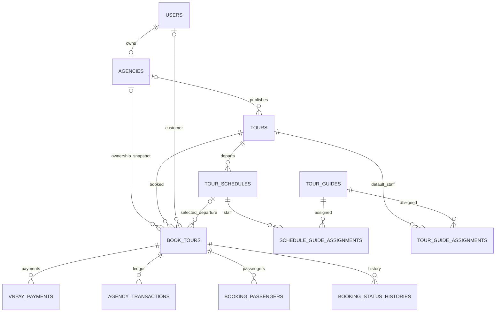

# Quan hệ database và cách vận hành

Cập nhật ngày 05/10/2026. Source du lịch Laravel; database cấu hình là `Travels`.

## Các thay đổi

- 44 quan hệ được khai báo FK và có index bắt đầu bằng cột liên kết. Bảng nối ACL chỉ cascade bản ghi phân quyền, không xóa người dùng.
- Booking không được xóa cứng, kể cả qua SQL trực tiếp. Dùng trạng thái hủy; lịch sử thanh toán, hành khách và thay đổi trạng thái được giữ lại. Tour, khách hàng và lịch khởi hành có booking bị chặn xóa.
- Người tạo nội dung có thể được xóa khi không vướng giao dịch; nội dung giữ nguyên và cột tác giả chuyển NULL. Địa điểm/danh mục đang được dùng phải được ẩn hoặc chuyển nội dung trước khi xóa.
- FK ghép `(b_tour_schedule_id, b_tour_id)` bảo đảm lịch thuộc đúng tour. Một tour chỉ có một đợt trong mỗi ngày, dù giờ khởi hành khác nhau; `departure_day` được database sinh tự động.
- `book_tours.agency_id` lưu đại lý lúc tạo đơn; không thay đổi khi tour chuyển chủ. Phân quyền xem booking và thống kê tiền dựa trên trường này. Tour và đại lý của booking không được sửa sau khi tạo.
- Booking cũ được điền đại lý từ tour hiện tại tại thời điểm nâng cấp. Không thể khôi phục chủ sở hữu lịch sử đã bị thay đổi trước đó nếu không có nguồn lịch sử riêng.
- `schedule_guide_assignments` lưu hướng dẫn viên/trưởng đoàn theo từng đợt. Nếu không có phân công riêng, dùng nhân sự chung của tour. Giao diện đại lý chỉ cho chọn nhân sự của chính đại lý hoặc nhân sự đã được gán vào tour; kiểm tra đúng vai trò và trạng thái hoạt động.
- Bình luận phải thuộc đúng một tour, bài viết hoặc khách sạn. Trả lời phải cùng đối tượng với bình luận cha. Đối tượng và bình luận cha không được đổi sau khi tạo; vẫn sửa được nội dung và duyệt/ẩn.
- Danh mục gốc dùng NULL; FK tự tham chiếu và trigger chống vòng lặp. Giá trị 0 cũ ở danh mục cha/bình luận cha được chuẩn hóa thành NULL.
- Số ghế còn lại đọc từ các booking chưa hủy; không phụ thuộc bộ đếm cũ.
- Bổ sung các quan hệ Eloquent hai chiều còn thiếu; quan hệ tới địa điểm không tự làm mất địa điểm chỉ vì địa điểm đang ẩn.

## Kiểm tra và nâng cấp

Các lệnh thực thi tại thư mục dự án, sử dụng kết nối trong cấu hình Laravel.

1. Sao lưu database (bảng, dữ liệu, trigger); xác nhận đúng database bằng `SELECT DATABASE()`.
2. `php artisan db:audit-integrity`: chỉ đọc, kiểm tra liên kết mồ côi, booking sai tour/lịch, lịch trùng ngày, đối tượng bình luận và vòng lặp cha/con. Lệnh yêu cầu các migration nền đã được chạy.
3. Nếu có dữ liệu mồ côi, không chạy migration bằng cách tắt khóa ngoại. Khôi phục/liên kết lại đúng theo dữ liệu nguồn. Không tự suy đoán tour, khách hay chủ sở hữu đã mất.
4. Trường hợp lịch trỏ tới tour đã mất nhưng không còn booking/phân công tham chiếu, hoặc nhật ký có actor đã mất:
   - `php artisan migrate --path=database/migrations/2026_10_05_000000_create_database_integrity_archives.php --force`
   - `php artisan db:repair-safe-orphans` xem số lượng, chưa ghi dữ liệu.
   - `php artisan db:repair-safe-orphans --apply` lưu nguyên dòng gốc vào `database_integrity_archives` trước khi chuyển lịch ra khỏi bảng hoạt động hoặc đặt actor NULL. Không sửa nội dung nhật ký. Dòng còn được tham chiếu bị chặn, không bị chuyển đi.
5. `php artisan db:audit-integrity`, rồi `php artisan migrate --force` và chạy audit lại.

Migration kiểm tra dữ liệu trước khi thêm ràng buộc. Migrations DDL trên MySQL/MariaDB không nguyên tử; thử trên bản sao trước và giữ bản sao lưu. Không chạy `migrate:fresh` trên database thật.

Migration hardening là **forward-only**: `down()` từ chối khôi phục cascade nguy hiểm hoặc xóa snapshot. Sửa tiếp bằng migration mới hoặc khôi phục bản sao lưu đã xác minh. Bảng archive không được rollback nếu còn dữ liệu.

Bảng `database_integrity_archives` cố ý không có FK về bản ghi nguồn vì nguồn có thể không còn tồn tại. Tương tự, subject đa hình và JSON của nhật ký/thông báo là tham chiếu lịch sử, không phải FK bắt buộc.

## Xác minh

- Test bootstrap dùng migration thật, không dựa vào schema giả lập.
- `DatabaseRelationshipsTest`: FK và quy tắc xóa, tour–lịch, lịch trùng ngày, ghế còn lại, ACL, bình luận, vòng lặp và snapshot đại lý.
- `DatabaseIntegrityUpgradeTest`: dừng trước khi thay đổi dữ liệu lỗi, chuyển bản ghi mồ côi có lưu nguyên trạng, không chuyển lịch còn booking, giữ lịch sử khi nâng cấp.
- `AgencyPortalTest`: phân quyền booking sau chuyển tour, nhân sự theo đợt và cách dùng nhân sự chung.
- Kiểm thử thêm trên bản sao MariaDB 10.4.28 của database thực tế; trigger danh mục dùng vòng lặp vì recursive CTE trong trigger không tương thích bản máy chủ này.

## Kết quả trên database thực tế

- Đã sao lưu bảng, dữ liệu và trigger vào `storage/app/backups/travels-before-integrity-20261005.sql` (quyền 0600, nằm ngoài Git).
- Máy chủ có lỗi hệ thống `mysql.proc` từ một lần nâng phiên bản MariaDB trước đó; vì vậy backup không xuất stored routines. Tác vụ này không chỉnh sửa routines hoặc bảng hệ thống MySQL. Việc sửa lỗi máy chủ cần quy trình nâng cấp riêng.
- Đã chạy thử trên database bản sao, kiểm tra 54 tình huống/ràng buộc trên MariaDB; các bản ghi test đều được rollback.
- 6 lịch mồ côi không còn booking/phân công tham chiếu được lưu nguyên trạng vào archive trước khi chuyển khỏi bảng lịch hoạt động. 1 nhật ký mất actor được lưu nguyên trạng trước khi đặt actor NULL. Không suy đoán hay gán tour/người dùng mới cho các dòng này.
- Biên bản đối chiếu số lượng dòng và checksum backup nằm tại `storage/app/backups/integrity-upgrade-20261005.json`.
